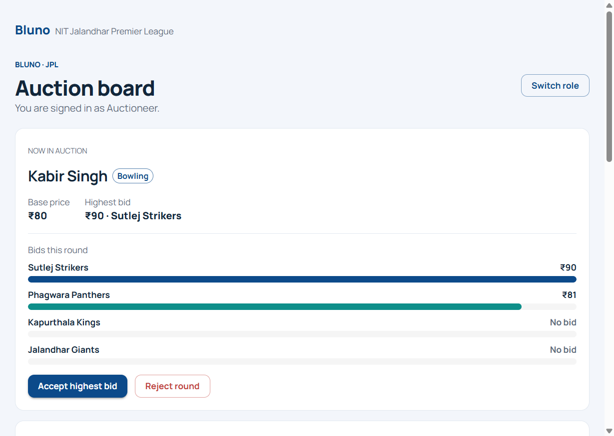
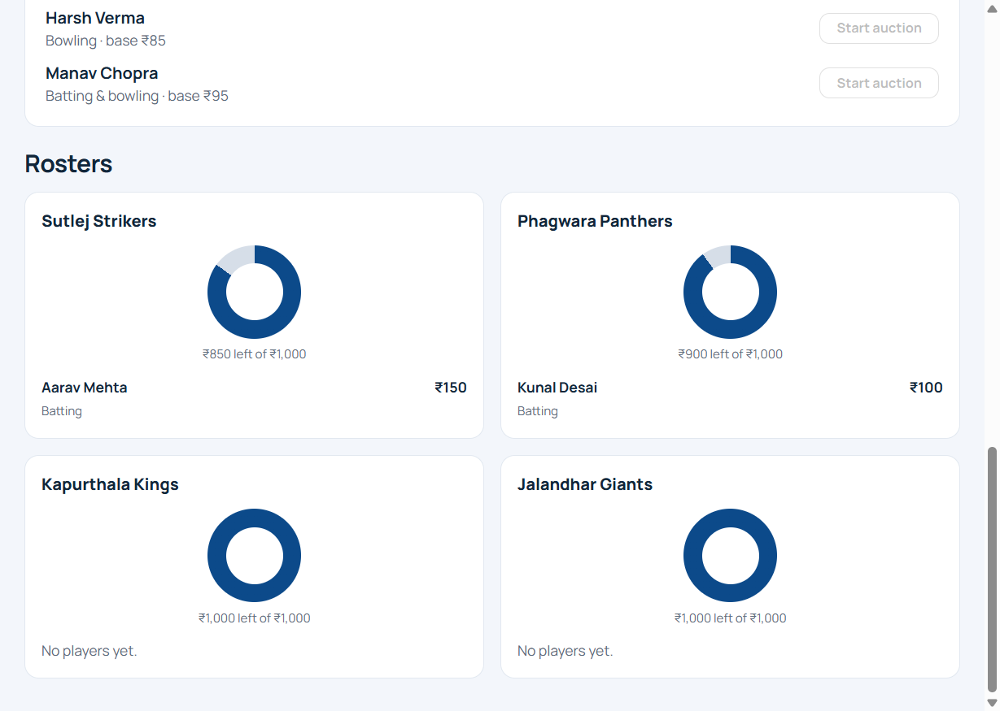

# NIT Jalandhar Premier League auction

A small auction board for the JPL assignment. Four team managers bid, one auctioneer accepts or rejects, and anyone else can watch. The UI is a React app with Material UI, themed as a light Bluno product (deep blue, white surfaces, Manrope). The current round is drawn as a bar chart, one bar per team. Each roster shows a donut of the purse still left, with the amount written underneath. The API is FastAPI with SQLite, so rosters and budgets survive a refresh and a server restart.

## How to run

Use two terminals.

Backend:

```powershell
cd backend
py -3.13 -m venv .venv
.\.venv\Scripts\python -m pip install -r requirements.txt
.\.venv\Scripts\python -m uvicorn app.main:app --reload
```

Frontend:

```powershell
cd frontend
npm install
npm run dev
```

Open http://localhost:5173 on the machine that is running the app. The Vite dev server listens on the local network and proxies `/api` to http://127.0.0.1:8000, so other browsers do not open the API port themselves.

When Vite starts it prints a Network address, for example `http://192.168.1.81:5173/`. Friends on the same Wi-Fi open that address. Everyone must use the same running server. A second copy of the app has its own database.

Tests:

```powershell
cd backend
.\.venv\Scripts\python -m pytest
```

To start from the seeded auction again, stop the API and delete `backend/jpl.db`. The next startup recreates the teams and players.

## How to play

1. One person starts the backend and the frontend.
2. Each person opens the site in their own browser, or in a separate tab on one computer.
3. On the first screen, pick a seat. Use one auctioneer, one manager for each of the four teams, and spectators for anyone else. The choice is saved in that browser only. Switch role clears it.
4. The auctioneer starts one available player. Managers place bids. The auctioneer accepts the highest bid or rejects the round.
5. The board refreshes about every 1.5 seconds, so every browser shows the same player, bids, rosters, and remaining budgets.

The bar chart lists every team for the player currently on the block. Bar length is that team's highest bid this round. A team that has not bid is labeled "No bid". The donut on a roster is blue for the purse still left and gray for the amount already spent. The caption under it reads like "₹900 left of ₹1,000".

## Budgets and bid rules

Each of the four teams starts with a purse of **₹1,000**:

- Sutlej Strikers
- Phagwara Panthers
- Kapurthala Kings
- Jalandhar Giants

Fourteen players are preloaded. Skill is `batting`, `bowling`, or `both`. Base prices are between ₹50 and ₹200. Status is `available`, `in_auction`, or `sold`.

Rules enforced by the server:

- Only one player can be in auction at a time.
- A bid is a positive integer greater than the base price and greater than the current highest active bid.
- The team that already holds the highest bid cannot bid again until another team outbids them.
- A bid above that team's remaining budget is refused.
- Accept assigns the player to the highest bidder, stores the sold price, and subtracts that price from the team's remaining budget.
- Accept with no bids is refused.
- Reject returns the player to `available`, does not assign a team, and voids that round's bids so the next auction starts clean.

The first screen is a role picker (auctioneer, one of the four managers, or spectator). The choice is stored in `localStorage`. It only controls which buttons are shown. The bid rules are checked on the server. The board polls `GET /api/state` every 1.5 seconds. There are no WebSockets, Server-Sent Events, or webhooks.

## API

Errors use `{ "detail": "message" }`. A malformed body returns **422**.

### `GET /api/state`

No request body.

Success **200**:

```json
{
  "teams": [
    {
      "id": 1,
      "name": "Sutlej Strikers",
      "total_budget": 1000,
      "remaining_budget": 1000,
      "roster": []
    }
  ],
  "players": [
    {
      "id": 1,
      "name": "Aarav Mehta",
      "skill": "batting",
      "base_price": 120,
      "status": "available",
      "sold_price": null,
      "team_id": null
    }
  ],
  "current_player": null,
  "bids": []
}
```

`bids` lists the active bids for the player currently in auction, oldest first. Each bid includes `id`, `player_id`, `team_id`, `team_name`, `amount`, `created_at`, and `voided` (always `false` in this list).

### `POST /api/auction/start`

```json
{ "player_id": 12 }
```

Success **200**: the same state object as `GET /api/state`, with that player `in_auction`.

| Status | `detail` |
| --- | --- |
| 404 | Player not found |
| 400 | Player is not available |
| 409 | Another player is already in auction |

### `POST /api/bids`

```json
{ "team_id": 1, "amount": 80 }
```

Success **200**: updated state, including the new bid.

| Status | `detail` |
| --- | --- |
| 404 | Team not found |
| 400 | No player is currently in auction |
| 400 | Bid must be greater than the base price |
| 400 | Bid must be greater than the current highest bid |
| 400 | Your team already holds the highest bid |
| 400 | Bid is higher than the team's remaining budget |
| 422 | `amount` is missing or not a positive integer |

### `POST /api/auction/accept`

No request body.

Success **200**: updated state. The player is `sold`, `sold_price` is the winning amount, `team_id` is the winning team, and that team's `remaining_budget` is reduced. `current_player` is `null`.

| Status | `detail` |
| --- | --- |
| 400 | No player is currently in auction |
| 400 | There is no bid to accept |

### `POST /api/auction/reject`

No request body.

Success **200**: updated state. The player is `available` again, with no team and no sold price. That round's bids are voided and no longer returned in `bids`.

| Status | `detail` |
| --- | --- |
| 400 | No player is currently in auction |

## Database schema

SQLite file: `backend/jpl.db`.

### `teams`

| Column | Type | Constraints |
| --- | --- | --- |
| `id` | INTEGER | primary key |
| `name` | VARCHAR(80) | not null, unique |
| `total_budget` | INTEGER | not null, check `total_budget >= 0` |
| `remaining_budget` | INTEGER | not null, check `remaining_budget >= 0` |

### `players`

| Column | Type | Constraints |
| --- | --- | --- |
| `id` | INTEGER | primary key |
| `name` | VARCHAR(120) | not null |
| `skill` | VARCHAR(20) | not null, check `skill IN ('batting', 'bowling', 'both')` |
| `base_price` | INTEGER | not null, check `base_price > 0` |
| `status` | VARCHAR(20) | not null, check `status IN ('available', 'in_auction', 'sold')` |
| `sold_price` | INTEGER | nullable |
| `team_id` | INTEGER | nullable, foreign key to `teams.id` |

### `bids`

| Column | Type | Constraints |
| --- | --- | --- |
| `id` | INTEGER | primary key |
| `player_id` | INTEGER | not null, foreign key to `players.id` |
| `team_id` | INTEGER | not null, foreign key to `teams.id` |
| `amount` | INTEGER | not null, check `amount > 0` |
| `created_at` | DATETIME | not null |
| `voided` | BOOLEAN | not null, default false |

Rejected rounds set `voided` to true. Those rows stay in the table and are ignored when deciding the highest bid.

## Screenshots

Auction board, with the current round as a bar chart:



Rosters, with the remaining purse on each donut:


